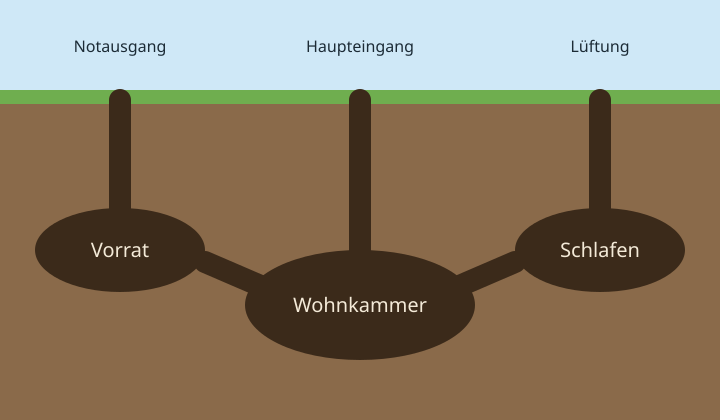
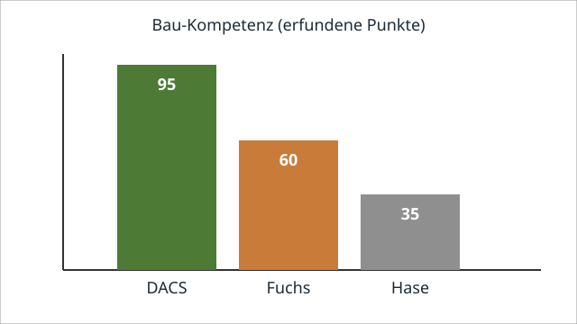

# Der Dacsbau – Architektur unter Tage

## Willkommen im Wald

Dieser Beispielkurs zeigt alle Elemente, die **md2ilias** in ein ILIAS-Lernmodul
umwandelt. Der Inhalt ist frei erfunden und augenzwinkernd gemeint: Es geht um den
*DACS* und seine Nachbarn im Wald, also um Fuchs, Hase, Eichhörnchen & Co.

!!! info "Hinweis zum Aufbau"
    Jede Zeile mit `#` beginnt ein Kapitel, jede Zeile mit `##` eine Seite des
    Lernmoduls. Alle Werte in diesem Kurs sind ausgedacht und dienen nur als Vorlage.


## Lernziele

- die Kammern eines Dacsbaus benennen,
- das Volumen einer Wohnkammer abschätzen,
- begründen, warum der DACS im Waldvergleich so gut abschneidet.

## Querschnitt des Baus

Ein Dacsbau ist ordentlich geplant: Der **Haupteingang** führt zur Wohnkammer, von dort
gehen Gänge zu Vorrat und Schlafplatz. Ein Notausgang und ein Lüftungsschacht sorgen für
Sicherheit und frische Luft.

<figure markdown>

<figcaption>Querschnitt eines Dacsbaus: Drei Zugänge, drei Kammern, keine Sackgassen.</figcaption>
</figure>

Die wichtigsten Bestandteile im Überblick:

- Haupteingang mit Fußabtreter (aus Laub)
- Wohnkammer mit Aussicht auf nichts, aber mit Stil
- Vorratskammer für Eicheln, Wurzeln und Würmer

Und so besucht man einen Dacsbau höflich:

1. Dreimal klopfen (auf den Baumstamm daneben).
2. Fünf Minuten warten.
3. Nur eintreten, wenn der DACS „Herein“ brummt.

!!! definition "Dacsbau"
    Ein unterirdisches Gangsystem mit mehreren Kammern, das über Generationen
    erweitert wird.

## Die Wohnkammer berechnen

Die Wohnkammer lässt sich als Ellipsoid mit den Halbachsen $a$, $b$ und $c$ annähern.
Für das Volumen gilt:

$$V = \frac{4}{3} \pi \, a \, b \, c$$

Mit $a = 0{,}9$ m, $b = 0{,}6$ m und $c = 0{,}5$ m ergibt sich etwa $V \approx 1{,}13$ m³.
Eine kleine Temperaturdifferenz \(\Delta T\) zwischen Bau und Außenwelt hält es dort
gemütlich.

!!! example "Beispiel: Platz für Gäste"
    Bei etwa 1,13 Kubikmetern passen der DACS, ein Vorrat und mit viel gutem Willen
    ein Eichhörnchen zu Besuch.

Wer es genau wissen will, prüft die Eigenschaften in einem kleinen Programm:

```python
def ist_dacs(tier):
    return tier["grabtiefe_m"] > 3 and tier["ordnungssinn"] >= 9
```

Und für die Ordnung im Bauverzeichnis genügt eine Zeile in der Shell:

```bash
ls bau/ && echo "Alles ordentlich" 2>&1
```

> Wer einen Bau sieht, ahnt den DACS.

::: {.lecture}
NUR-FÜR-DIE-LEHRPERSON: Dieser Hinweis gehört nicht ins Lernmodul.
:::

# Nachbarn im Vergleich

## Wer kann was?

Wie schlagen sich die Nachbarn im Vergleich? Die folgende Tabelle ist ein Spaß und
beruht auf erfundenen Werten.

| Eigenschaft | DACS | Fuchs | Hase |
|---|---|---|---|
| Grabtiefe in m | 4 | 1,5 | 0,3 |
| Nachtaktiv | ja | meistens | dämmerungsaktiv |
| Ordnungssinn (1 bis 10) | 10 | 6 | 3 |
| Gästezimmer | 2 | 0 | 0 |

<figure markdown>

<figcaption>Bau-Kompetenz im Vergleich (erfundene Punkte, rein zum Vergnügen).</figcaption>
</figure>

!!! warning "Nicht nachmachen"
    Bitte keine echten Dacsbauten öffnen oder vermessen. Wildtiere schätzen ihre Ruhe.

## Stimmen aus dem Wald

Die Nachbarn nehmen es sportlich:

!!! quote "Der Fuchs"
    Ein schöner Bau, aber meiner hat mehr Ausblick.

!!! tip "Merke"
    Tiefe schlägt Aussicht: Je tiefer der Bau, desto ruhiger der Schlaf.

??? success "Lösung: Wer schläft am ruhigsten?"
    Der DACS, denn sein Schlafplatz liegt am tiefsten.

## Mini-Check

<div class="li-quiz" data-explanation="Der DACS gräbt mit etwa vier Metern den tiefsten Bau der drei Nachbarn." markdown>
**Wer gräbt den tiefsten Bau?**

<button data-answer="wrong">Der Hase.</button>
<button data-answer="correct">Der DACS.</button>
<button data-answer="wrong">Der Fuchs.</button>
<div class="li-quiz-feedback"></div>
</div>

<div class="li-quiz" data-explanation="Die Wohnkammer ist der zentrale Raum, von dem die Gänge zu Vorrat und Schlafplatz abgehen." markdown>
**Welche Kammer liegt im Zentrum des Baus?**

<button data-answer="correct">Die Wohnkammer.</button>
<button data-answer="wrong">Die Vorratskammer.</button>
<button data-answer="wrong">Der Lüftungsschacht.</button>
<div class="li-quiz-feedback"></div>
</div>

<div class="quiz" data-question-type="single-choice" markdown>
**Was berechnet die Formel mit dem Ellipsoid?**

- [ ] die Temperatur im Bau
- [x] das Volumen der Wohnkammer
- [ ] die Zahl der Eingänge

??? success "Feedback"
    Das Ellipsoid-Volumen $V = \frac{4}{3} \pi a b c$ beschreibt den Raum der Wohnkammer.
</div>

# Warum der DACS gewinnt

## Die Überlegenheitsformel

Wissenschaftlich unanfechtbar ist die **DACS-Überlegenheitsformel**:

$$U = \frac{T \cdot O}{L}$$

Dabei steht $T$ für die Grabtiefe, $O$ für den Ordnungssinn und $L$ für die Lautstärke
beim Umziehen. Wer tief gräbt, ordentlich wohnt und leise bleibt, gewinnt. Wie im
[Vergleich der Nachbarn](#wer-kann-was) zu sehen ist, liegt der DACS bei allen drei
Größen vorn.

Die Bauweise erklärt viel: Den [Querschnitt des Baus](#querschnitt-des-baus) und die
[Rechnung zur Wohnkammer](#die-wohnkammer-berechnen) finden Sie in Kapitel 1.


Weitere Hintergründe zum Lebensraum bietet der [Wikipedia-Artikel zum Wald](https://de.wikipedia.org/wiki/Wald).

## Übung

<div class="li-mini-task" markdown>
**Aufgabe 1**

Setzen Sie in die Überlegenheitsformel ein: $T = 4$, $O = 10$ und $L = 2$. Erklären Sie,
was passiert, wenn der DACS beim Umziehen doppelt so laut ist.
</div>

??? success "Lösung"
    Es ergibt sich $U = \frac{4 \cdot 10}{2} = 20$. Bei doppelter Lautstärke ($L = 4$)
    halbiert sich die Überlegenheit auf $U = 10$.

## Zusammenfassung

- Der Dacsbau besteht aus Wohnkammer, Vorrat, Schlafplatz und drei Zugängen.
- Die Wohnkammer lässt sich als Ellipsoid abschätzen.
- Im Vergleich mit Fuchs und Hase liegt der DACS bei Grabtiefe und Ordnung vorn.

## Ausblick

Im nächsten Schritt können Sie eigene Kapitel ergänzen. Zurück zum Anfang geht es
über [Willkommen im Wald](#willkommen-im-wald).
